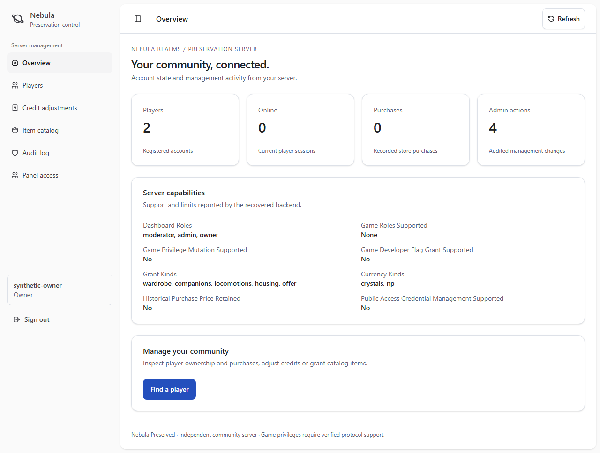

# Nebula Preserved

### Reconstructing the services behind Nebula Realms.

A community preservation project for the Windows Steam client: accounts,
characters, items, social features and persistent worlds, hosted on Linux.
The separate operator dashboard uses Astro, React and shadcn/ui.

**[Quickstart →](deployment/docker/README.md#pull-published-images-from-ghcr)** ·
[Administration](admin-panel/README.md) ·
[Ubuntu automation](deployment/ansible/README.md) ·
[Windows launcher](docs/LAUNCHER.md) ·
[Moderation](docs/MODERATION-OPERATIONS.md) ·
[Client patching](client-patches/network-only/README.md) ·
[Project status](docs/PROGRESS.md) ·
[Rust server candidate](experimental/rust-server/README.md) ·
[Contributing](CONTRIBUTING.md)

> **Development snapshot.** This is not a completed multiplayer release.
> Native public-client login, final shared-server acceptance, apartment flows
> and equipped-resource reconciliation still need verification. The
> [status matrix](docs/PROGRESS.md) records the evidence and remaining work.

Operator dashboard preview

*Dashboard shown with disposable test data.*

## What is being preserved

| Service | Reconstruction |
|---|---|
| Accounts and characters | Replacement accounts, avatar presets, customization and saved preferences |
| Items and stores | Inventory, local wallets, catalog offers, purchases and audited operator grants |
| Social and worlds | Friends, chat, invitations, scene allocation and apartment ownership/layouts |
| Administration | Player lookup, credits, grants, purchase history, moderation, reports, roles and audit records |

Earlier native tests demonstrated two clients in Nexus, public/private chat,
friendship, character/settings persistence and one store purchase. Linux Docker
and the panel have passed isolated synthetic runtime, persistence and TLS
boundary checks. Those results do not establish complete original-client
connectivity through the final distribution. The target is the original
networking and persistent state; minigame integration remains deferred in the
current snapshot. See the status matrix for incomplete flows.

The default client patch changes networking compatibility and server routing.
It retains the shipped interface, input and rendering. Original cosmetic/gameplay
bugs remain outside this project's networking scope. Optional input experiments
are documented separately in [controls](docs/CONTROLS.md).

## Start a server

The runtime target is **Linux x86_64 with Docker Engine and Compose**. Use a
published server/panel image pair with its matching `runtime.env`, create your
own operator secrets, then follow the [Docker quickstart](deployment/docker/README.md#pull-published-images-from-ghcr).
Image availability depends on the maintainer publishing a reviewed build.

For a dedicated Ubuntu 26.04 host, the [Ansible playbook](deployment/ansible/README.md)
installs Docker, loads a reviewed image archive, configures TLS and persistent
boot services, and enables consistent daily backups. Its health checks remain
separate from native game-client acceptance.

Building images yourself instead requires the complete matching Linux Unity
server build and validation report. The [setup guide](docs/SETUP.md) covers
preparing those inputs from source.

Runtime hosting does not require host Unity, Python, Node or Rust installations
when using the complete images. This source checkout contains no generated
Unity runtime, game assets, player database or credentials.

| Deployment | Boundary |
|---|---|
| Default private profile | Loopback only; explicitly configure a trusted LAN/VPN for other players |
| Public profile | Per-account credentials, explicit auth migration and operator-managed TLS |
| Operator panel | Loopback by default; internal management API remains unpublished |

There are no default passwords. Bootstrap private secrets and make them readable
by container UID 1000 using the documented permissions. Keep the named state
volume and separate secrets across upgrades; see [backup and lifecycle guidance](deployment/docker/README.md#lifecycle-and-health).

Compose needs matching image/runtime metadata, configuration and secrets. It is
not a universal one-click deployment: the operator still supplies credentials,
network/TLS configuration and persistent storage.

## How it fits together

| Component | Stack | Source |
|---|---|---|
| Account, inventory, shop, social and persistence services | Python · aiohttp · SQLite | [backend](backend/) |
| Reconstructed scene servers | C# · Unity · Mirror v66.0.9 / Telepathy | [mirror-server](mirror-server/) |
| Operator dashboard | Astro SSR · React · shadcn/ui | [admin-panel](admin-panel/) |
| Hosting and ingress | Linux · Docker Compose | [deployment/docker](deployment/docker/) |
| Steam discovery, patching and restore | Rust | [patcher](patcher/) |
| Networking compatibility | Native/managed patch recipes | [client-patches](client-patches/) |
| Recovered contracts | Manifests and protocol research | [protocol](protocol/) |

The matching client is Steam app **919290**, build **11018722**. Players supply
their own installation. The networking-only patcher uses exact version/hash
checks, backups and receipt-backed restore; no complete game is distributed.

Mirror provides historical framing and serializers. Game-specific services are
reconstructed from shipped behavior. Publisher server code, historical accounts,
retired service data and original store policy were not recovered. Replacement
credits and offers use explicit local policy; real Steam commerce is disconnected.

## Work on the project

Start with [setup](docs/SETUP.md), [testing](docs/TESTING.md) and
[contribution guidelines](CONTRIBUTING.md). Review [security](SECURITY.md) and
[privacy](docs/PRIVACY.md) before sharing logs or operating a server.
[Releases](docs/RELEASES.md) and [publication checks](docs/PUBLISHING.md) describe
the separate source, image and client-bundle gates.

Original project contributions are licensed under [MIT](LICENSE). Vendored
components retain their [upstream terms](THIRD_PARTY_NOTICES.md); this license
does not cover the original game or grant rights to its assets. See
[licensing scope](docs/LICENSING.md) for the source and release boundaries.
Publication workflows are provided; assembling this checkout has not executed
them remotely or published a repository, image or patch bundle.
